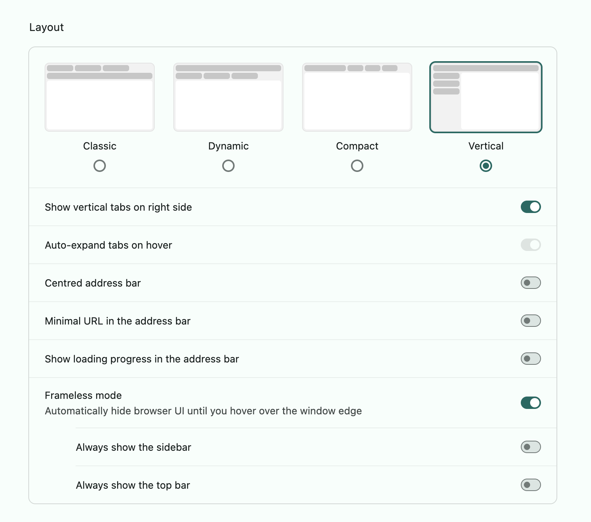

# Browser settings

Compass replaces the browser's own tabs and toolbar, so it looks best when the browser gets out of the way. This page collects the settings that work well, one section per browser. Only Helium is written up so far. If you have a setup that works in another browser, open a pull request and add a section.

- [Helium](#helium)
- [Chrome](#chrome)
- [Other Chromium browsers](#other-chromium-browsers)

## Helium

Compass was built in Helium and gets tested there every day.

Open Helium's settings (`Cmd+,`), find **Layout**, and set:

- **Vertical** layout
- **Show vertical tabs on right side**: on. Compass's sidebar lives on the left edge, so Helium's tabs move to the right and the two don't overlap.
- **Frameless mode**: on. Hides Helium's toolbar until you hover the window edge, so the page fills the window and Compass is all you see.

Leave the rest off.

Compass's **Auto** theme follows the system's light or dark setting. Chromium does not report a custom browser theme to extensions, so if Helium's theme is dark while your system is light, choose **Dark** in Compass's options.

Helium can also copy the page address itself with `Cmd+Shift+C`: under **Appearance**, **Behavior**, choose what that key does. Compass's own Copy URL is for Chrome, where that key opens Inspect element.

## Chrome

Everything works, with the tab strip still showing at the top. Chrome has no vertical tabs or frameless mode to turn on. The sidebar docks into Chrome's side panel when you pin it.

Chrome keeps `Cmd+Shift+C` for Inspect element, so Compass's Copy URL uses `Cmd+Shift+L`. If it shows as not set, give it a key at `chrome://extensions/shortcuts`.

## Other Chromium browsers

Compass loads in Edge and Brave the same way, but nobody has written up the settings yet. Edge has vertical tabs under **Appearance**, which should pair with the sidebar the same way Helium's do. If you try one, add what you find here.
