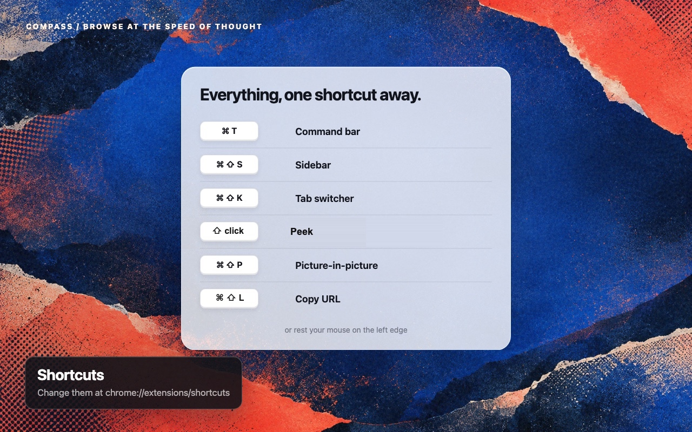
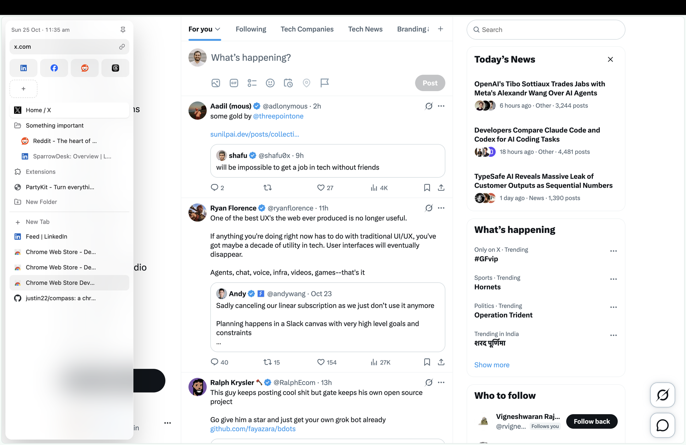
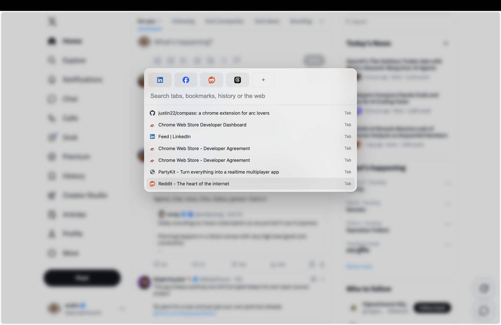
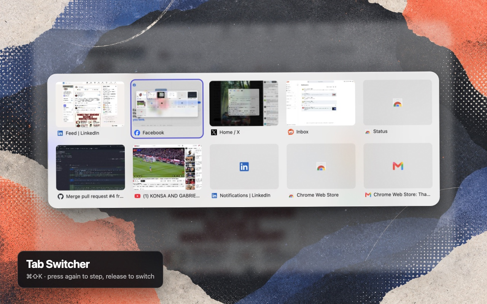
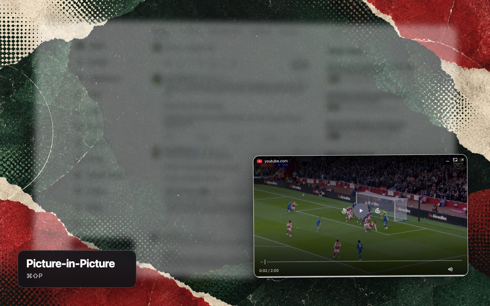

# Compass

> **Heads up: no human has reviewed this code.** All of it was written by an AI model (an LLM). I use Compass every day as my own browser setup and try every change by hand before it ships. But I haven't read the code, and there are no plans to review it soon. Several AI models do review each change for security, accessibility, memory use and good practice in the design and the logic, and their fixes go in before it ships. That still isn't a person reading it. Keep that in mind before you install it, especially since it asks for access to your tabs, history and bookmarks.
>
> **No data collection.** Compass has no server, no analytics and no tracking, and it never sends your data anywhere. Everything stays in your browser. Favorites and Pinned are ordinary bookmarks, so they sync only if you have turned on your browser's own sync.

A command bar and sidebar for Chrome and other Chromium browsers (Helium, Edge, Brave). It borrows the parts of Arc that were worth keeping: one search box for everything, a sidebar that stays out of the way, and old tabs that clean themselves up.

Chrome extension, no build step, no dependencies.

[Highlights](#highlights) · [What it does](#what-it-does) · [How it works](HOW-IT-WORKS.md) · [Install](#install) · [Browser settings](BROWSERS.md) · [Files](#files) · [Test](#test) · [Contributing](#contributing) · [Things to know](#things-to-know)

## Highlights

- **[Command bar](#command-bar)**: `Cmd+T` searches open tabs, bookmarks, history and the web from one box. `Cmd+1` to `Cmd+9` opens a favorite, `Cmd+Shift+L` copies the page address.
- **[Sidebar](#sidebar)**: your tabs in a vertical list. `Cmd+Shift+S`, or rest your mouse on the left edge.
- **[Tab switcher](#tab-switcher)**: `Cmd+Shift+K` shows your recent tabs as previews. Press again to step through, let go to switch.
- **[Pinned](#pinned)**: tabs you keep, in folders, at the top of the sidebar. They sync as bookmarks.
- **[Picture-in-picture](#picture-in-picture)**: `Cmd+Shift+P` pops the page's video into a floating window that stays on top.
- **[Auto-archive](#auto-archive)**: tabs you haven't touched in 12 hours close themselves and stay searchable.

Shortcuts are written for Mac. On Windows and Linux, read `Cmd` as `Ctrl`. Change any of them at `chrome://extensions/shortcuts`.



## What it does





### Command bar

`Cmd+T`, or click the Compass icon in the toolbar. A search box that pops up over the page. Cmd+T closes the blank new tab and opens the bar over the page you were on instead, so you may see a brief flash. It searches open tabs, bookmarks, history and archived tabs in one list. A web address opens, anything else searches the web.

- Press Enter on an empty bar to jump back to the last tab you were on.
- Type a site name like `yt` or `reddit`, press Tab, and search that site directly. About a dozen popular sites are built in.
- Your favorites sit at the top. `Cmd+1` to `Cmd+9` opens them.

### Sidebar

`Cmd+Shift+S`, or rest your mouse on the left edge of the window. A vertical list of your open tabs, floating over the page. Click a tab to switch to it. Drag to reorder. Middle-click to close.

- An address field at the top shows the current site. Click it to edit, Enter to navigate.
- A pin button keeps the sidebar open as a docked side panel. Click it again to close.
- Double-click a tab to rename it. The name lasts until the tab or the browser closes, and shows only in the sidebar. In the floating sidebar a click switches tabs and closes it, so double-click only works on the current tab. The docked panel renames any tab.
- Arrow keys move through tabs, Enter opens one, Escape closes the sidebar.
- Hover the chart button at the bottom right for a status panel: tab counts, when auto-archive runs next and what it closed last, how much space the tab previews and the archive use, and which shortcuts are set. A button there clears the previews.
- The trash button at the bottom left closes your other open tabs. Click it, then click again to confirm. Pinned items, tabs pinned in Chrome and the tab you're on stay. Closed tabs go to the archive, so the command bar can still find them.

### Tab switcher



`Cmd+Shift+K`. The tabs in this window as a grid, most recent first, each with a small picture of the page. It starts on the tab you were on before, so one press and release jumps back. Hold `Cmd` and press `Shift+K` again to step through them, then let go to switch. Or use the arrow keys and Enter, or click a tab. Escape closes it.

- A tab you haven't looked at since the browser started shows its icon on grey instead of a picture. The picture appears once you visit it.
- Pictures are kept in memory only and are gone when the browser closes.
- If you installed Compass before this feature existed, `Cmd+Shift+K` may still be set to open the command bar. Move it at `chrome://extensions/shortcuts`.

### Favorites

Your top sites, shown as icons in both the bar and the sidebar. Press `+` to add the current page, `×` (or the Delete key on a focused icon) to remove one. They are stored as a "Favorites" bookmark folder, so they sync and you can edit them in the bookmark manager.

### Pinned

Tabs you want to keep, at the top of the sidebar. Click the pin on a tab to pin it, or drag it up into Pinned. Click a pinned tab to open it. Its `⋯` menu has Rename and Unpin. Pinned tabs are stored as a "Pinned" bookmark folder, so they sync.

- The folder button at the bottom right adds a folder. Double-click a pinned tab or folder to rename it.
- Drag to reorder, or drop onto a folder to put it inside.
- A pinned tab stays pinned wherever you browse in it. Once you leave the pinned page, a back arrow appears. Click it to go back, or pick **Pin this page instead** from the `⋯` menu to keep the page you're on now.
- `×` on a folder deletes it and everything in it.

### New tab toast

Open a link in a background tab (`Cmd+click`) and a small "New tab opened" note shows at the top of the page for a few seconds. Click it to go to that tab.

### Copy URL

`Cmd+Shift+L` copies the current page address. No popup, no confirmation. It was `Cmd+Shift+C` before, but Chrome keeps that for Inspect element. If you installed Compass before this change, the key may be unset. Set it at `chrome://extensions/shortcuts`, or from the sidebar's status panel.

### Picture-in-picture



`Cmd+Shift+P` pops the video on the page out into a small floating window that stays on top. Press it again on the same page to put it back. If there are several videos, it picks the biggest one that is playing, or else the biggest. On Windows and Linux the default `Ctrl+Shift+P` may clash with the browser's print shortcut; change it at `chrome://extensions/shortcuts` if it doesn't fire. Works on sites that hide the video inside a custom player, like Reddit. Videos embedded from another site (like a YouTube video inside a blog post) aren't picked up yet.

### Auto-archive

Every 30 minutes, tabs you have not touched in 12 hours close on their own. They are saved first, so the command bar can still find them. Pinned items, favorites, the active tab and anything playing audio are left alone.

## Install

Compass is not on the Chrome Web Store. You load it from a folder on your computer. Works in Helium, Chrome, Edge and Brave.

**Get the code**

Click the green **Code** button at the top of this page, then **Download ZIP**. Unzip it somewhere you will keep it. The browser loads the extension from this folder every time it starts, so don't delete or move it afterwards.

Or clone it:

```
git clone https://github.com/justin22/compass.git
```

**Load it in the browser**

1. Open `chrome://extensions` (in Edge, `edge://extensions`).
2. Turn on **Developer mode** (top right).
3. Click **Load unpacked** and pick the folder you just cloned or unzipped.
4. Press `Cmd+Shift+S` on any web page. The sidebar should slide in.

**Update**

Run `git pull` in the folder (or download the ZIP again and replace the folder's contents), then open `chrome://extensions` and click the reload icon on the Compass card. Pages that were already open need a refresh before the edge hover works on them again.

## Browser settings

Compass looks best when the browser's own tabs and toolbar get out of the way. [Browser settings](BROWSERS.md) has the settings that work, one section per browser. Only Helium is written up so far.

## Files

| File | What it is |
|---|---|
| `manifest.json` | Extension setup: permissions, shortcuts, icons |
| `background.js` | Listens for shortcuts, opens the overlay, runs the archive timer |
| `overlay.js` | Draws the floating panel over the page |
| `content.js` | Watches for the mouse resting on the left edge |
| `bar.html` / `bar.js` | The command bar |
| `sidebar.html` / `sidebar.js` | The sidebar |
| `switch.html` / `switch.js` | The tab switcher |
| `favs.js` | Favorites and Pinned, shared by the bar and the sidebar |
| `archive.js` | Decides which tabs are stale enough to close, and saves closed tabs to the archive |
| `archive.test.mjs` | One check for the archive logic |
| `HOW-IT-WORKS.md` | What each feature is underneath, in plain words |
| `BROWSERS.md` | Settings that work well, one section per browser |

## Test

```
node archive.test.mjs
```

Prints `archive ok` if the archive rules still hold.

## Contributing

Issues and pull requests are welcome. Read [CONTRIBUTING.md](CONTRIBUTING.md)
before starting. Pull requests with a user-visible change need a short video
showing its impact.

## Things to know

- The overlay cannot draw on browser pages like `chrome://settings` or the Web Store. The bar falls back to the toolbar popup there, and the sidebar opens as the native side panel. The browser decides which side that panel is on. In Chrome you can move it to the left at `chrome://settings/appearance` (**Side panel position**).
- The 12 hour archive limit and the 150ms edge hover delay are fixed in code. Change them in `archive.js` and `content.js` if they feel wrong.
- To add a search site, add a line to the `ENGINES` list in `bar.js`.

## Credits

Icons by [Lucide](https://lucide.dev).
